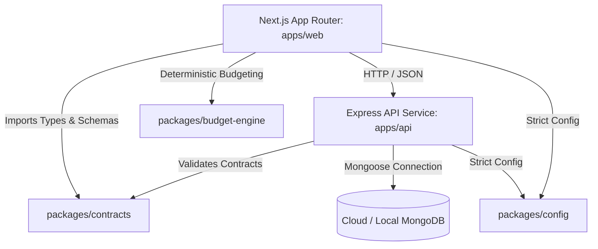

# WanderSphere — System Architecture (Phase 0)

## 1. Architectural Philosophy

WanderSphere is engineered as a resilient, modular, and type-safe platform. To support rapid feature growth without architectural rewrites, Phase 0 establishes clean separation of concerns using a **pnpm TypeScript monorepo**.

---

## 2. Monorepo Organization & Boundaries

### 2.1 `apps/web` (Frontend Application Shell)

- **Framework:** Next.js 15 with React 19 and App Router.
- **Styling:** Tailwind CSS with deep canvas surfaces (`#080E1A`, `#0F172A`), warm amber accents (`#F59E0B`), and teal indicators (`#0D9488`).
- **Typography:** Editorial serif headings paired with clean sans-serif body text.
- **Accessibility:** Semantic HTML landmarks (`<main>`, `<header>`, `<nav>`, `<article>`), WCAG AA compliant focus rings (`:focus-visible`), explicit skip-links, and `@media (prefers-reduced-motion)` suppression of non-critical animations.
- **Workspaces:** Dedicated route shells for `/traveler`, `/planner`, and `/admin` with clear Phase 0 indicators to prevent feature pretense.
- **Three.js Planetary Boundary:** The `<GlobeBoundary />` component encapsulates layout dimensions and placeholder fallbacks, ensuring future Three.js bundle additions do not degrade initial page hydration or Core Web Vitals.

### 2.2 `apps/api` (Backend Service)

- **Framework:** Node.js with Express and TypeScript in strict mode.
- **Entrypoints:**
  - `src/app.ts`: Creates Express application, mounts security headers (Helmet), CORS, JSON parsers, request-id, structured logging, routes, and centralized error handling.
  - `src/server.ts`: Handles process lifecycle, database connection attempts, and graceful termination hooks (`SIGTERM`, `SIGINT`).
- **Middleware Chain:**
  1. `Helmet`: Secure HTTP headers (CSP, HSTS, frameguard).
  2. `CORS`: Origin whitelisting based on the `CORS_ORIGIN` environment variable.
  3. `requestIdMiddleware`: Inspects or injects UUIDv4 `X-Request-Id` headers.
  4. `structuredLogger`: Emits structured JSON logs containing request IDs, methods, paths, status codes, and execution duration.
  5. `BodyParsers`: Strict `1mb` size limits preventing payload-based denial of service.
  6. `notFoundHandler`: Structured 404 responses matching API contracts.
  7. `errorHandler`: Centralized operational error processing with stack trace sanitization in production.

### 2.3 `packages/contracts` (Shared Schemas & API Types)

- Eliminates drift between API and client by sharing single-source-of-truth Zod schemas.
- Exports validated contracts for:
  - System health and dependency probes (`HealthResponseSchema`).
  - Standardized error payloads (`ApiErrorResponseSchema`).
  - Travel domain baseline entities (`DestinationSchema`, `CommunityPostPreviewSchema`, `TripOverviewSchema`).

### 2.4 `packages/budget-engine` (Deterministic Travel Cost Calculator)

- Reserved pure TypeScript package isolated from UI frameworks.
- Implements deterministic budgeting formulas that distribute daily expenses across accommodation, transport, food, activities, and contingency buffers without floating-point drift.
- Validates all calculation inputs with Zod and provides pure, unit-tested functions.

### 2.5 `packages/config`

- Exports base TypeScript configuration files (`base.json`, `node.json`, `react.json`) ensuring strict compiler checks across all workspaces (`noImplicitAny`, `strictNullChecks`, `noUncheckedIndexedAccess`).
- Exports baseline ESLint configuration.

---

## 3. Database Strategy & Readiness Model

- **ORM / ODM:** Mongoose 8.x with TypeScript typings.
- **Connection Management:** Handled via `src/database/connection.ts`.
- **Readiness Verification:**
  - The health check (`GET /api/v1/health`) executes an actual `admin.ping()` command against MongoDB if configured.
  - If `MONGODB_REQUIRED=true` and the database is unreachable, the API returns `503 Service Unavailable` with `status: "down"`.
  - If `MONGODB_REQUIRED=false` (e.g., local development without local MongoDB), the API starts in database-independent mode and reports `database: "not_configured"` without claiming active connectivity.

---

## 4. Future Phases Roadmap

- **Phase 1: Identity & Community Hub:** User registration, JWT / session auth, traveler profiles, and real community story publishing.
- **Phase 2: 3D Planetary Route Engine & Live APIs:** Integration of Three.js into `<GlobeBoundary />`, multi-modal route planning, and Indian Railways / flight schedule data adapters.
- **Phase 3: Real-Time Itinerary Collaboration:** WebSockets for multi-user itinerary planning, offline PWA caching, and automated booking export.
